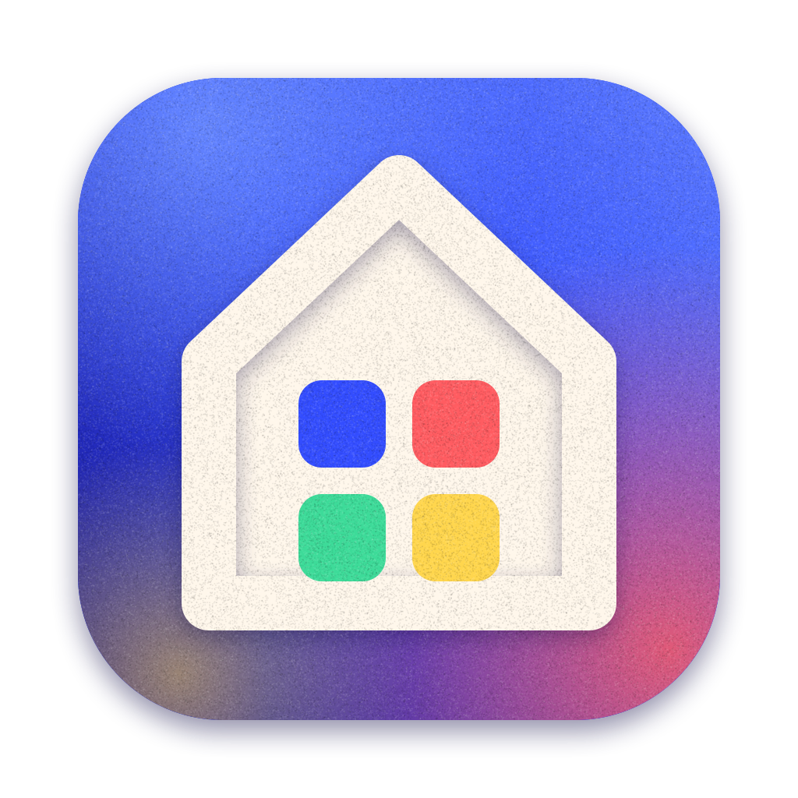
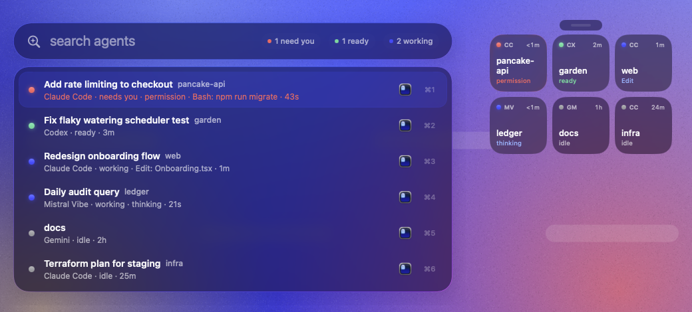

<p align="center">
  
</p>

<h1 align="center">barn</h1>

<p align="center"><b>a little barn for all your agents.</b><br>
A tiny macOS menu-bar app that watches every AI coding agent on your Mac and gets you to the one that needs you, in one keystroke.</p>

<p align="center">
  <a href="https://github.com/immannino/barn.app/releases/latest/download/barn.dmg"><b>download for mac</b></a> ·
  <a href="https://barn.ope.cool">barn.ope.cool</a> ·
  <code>brew install --cask immannino/tap/barn</code>
</p>

<p align="center"></p>

---

Running five agents in five repos? barn shows you, at a glance, which ones are **working**, which ones are **done**, and which one has been sitting on a permission prompt for ten minutes. It takes you to that agent's exact terminal tab with **⌃⌥Space**.

You don't have to start your agents through barn, and there's nothing to configure. It notices them on its own.

## What you get

- **⌃⌥Space: the switcher.** Spotlight for your agents. Type to filter and press ↵ (or ⌘1–9) to jump to the exact Ghostty split, iTerm or Terminal tab, tmux pane, or editor window. The most urgent agents sort to the top.
- **The menu bar.** One dot per agent: 🔴 needs you · 🟢 ready · 🔵 working · ⚪ idle.
- **⌃⌥D: the floating deck.** Liquid Glass tiles that stay on top and follow you across desktops, like a Stream Deck for when you're away from your desk.
- **Notifications** when an agent needs you. Click one and you're there.
- **Settings** for every shortcut (with conflict warnings), launch at login, one-click hook setup, and adding your own agents.

## Works with

| | |
|---|---|
| **exact out of the box** | Claude Code, Mistral Vibe |
| **exact with one click** (settings → agents) | Codex, Gemini CLI, Copilot CLI, Factory Droid, Qwen Code, Auggie |
| **detected by activity** | opencode, Amp, Cursor Agent, Aider, Goose, Crush, Kiro, Cline, Kimi, Pi, Kilo, Antigravity |
| **anything else** | add it by process name, or have it write `~/.barn/status/<pid>.json` |

Anything can report exact state: point its hooks at `barn hook <name>`, or from a script:

```sh
echo '{"state":"waiting","detail":"approve deploy"}' > ~/.barn/status/$PPID.json
```

## Install

**Download** [barn.dmg](https://github.com/immannino/barn.app/releases/latest/download/barn.dmg), open it, and drag barn to Applications. Or use Homebrew:

```sh
brew install --cask immannino/tap/barn
```

The first time you jump to a terminal, macOS asks whether barn may control it. Say OK; that's how barn picks the exact tab. barn needs macOS 14 or later and looks best on macOS 26.

**From source:** `git clone https://github.com/immannino/barn.app && cd barn.app && make install` (needs Xcode 26).

## Privacy

barn has no account, no telemetry and no analytics. Its only network request is the update check, which fetches `barn.ope.cool/appcast.xml` once a day; turn it off in settings → general. It reads the process table and your agents' local session files, and writes only to `~/.barn`, its log (`~/Library/Logs/barn.log`) and its preferences. Hook setup edits a config only when you click it, and backs the file up first.

## FAQ

**Do I have to start agents through barn?** No. Run them however you like; barn notices within a second.

**Why does it want to control my terminal?** It uses Apple Events to bring the right window and tab to the front, the same way Raycast or Alfred do.

**My agent isn't listed.** Settings → agents → your own: add its process name. If it has hooks, point them at `barn hook <name>` for exact state.

**Does it slow anything down?** It uses under 1% of one CPU core.

## Contributing

PRs are welcome, especially new agents and terminals. See [docs/DEVELOPMENT.md](docs/DEVELOPMENT.md) for how detection and focusing work, and [docs/RELEASING.md](docs/RELEASING.md) for signing and releases.

<p align="center"><sub>made in a little barn by tony</sub></p>
